# TryHackMe MADNESS ROOM 
## by tunlp


To begin, I run a port scan with `nmap`

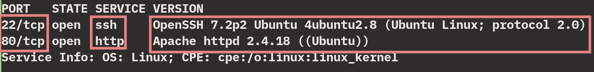

Since there is an `http` service on port `80`, I enter the machine's IP into the browser

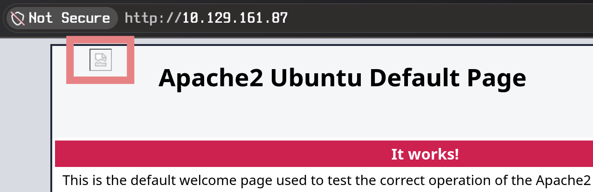

I see it's the `apache` 'default' page; meanwhile there's an image that doesn't load, so I try to open it in the browser

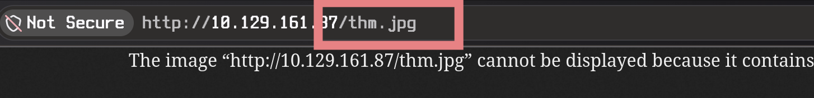

I use `wget` to download the full image

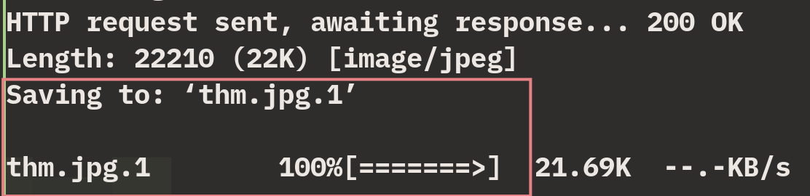

I analyze the image with the `file` command and it responds with `thm.jpg: data`. The file is data, not content... Either way, I run an analysis with `binwalk` to check whether it hides any files

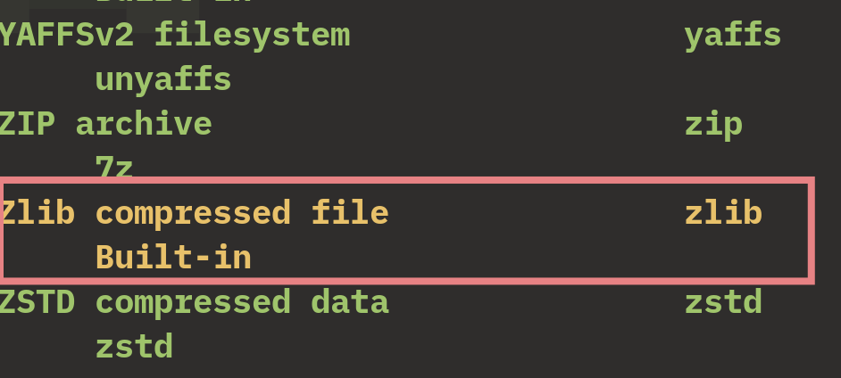

I try to extract the hidden files with `foremost` and `7z`, but neither works, so I proceed to analyze it in `hexedit` to see if its hexadecimal format gives us any clue

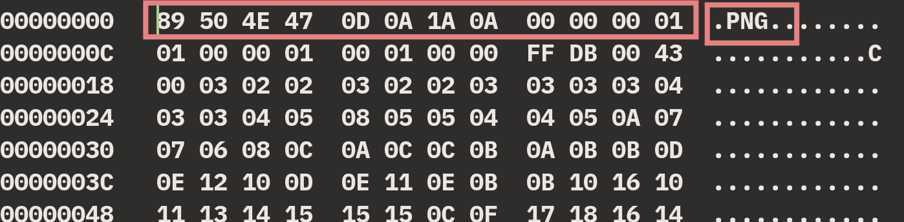

The first 8 bytes of the image's `hexdump` say the format is `png` even though it's called `thm.jpg`. I research the header and learn that the `PNG` and `JPG/JPEG` formats have their first 8 bytes in the following hexadecimal format

```
PNG=>  89 50 4E 47 0D 0A 1A 0A
JPEG=> FF D8 FF E0 00 10 1A 4A 
```
The next 3 bytes in a JPEG image correspond to the format. The last byte `4A` represents the letter `J`; starting from it, the next 3 bytes must spell the word `JFIF` | `46 49 46` (JPEG File Interchange Format), like a registered mark that confirms the file is `JPEG`, so I'll replace the current first 11 bytes with the ones that correspond to a JPEG image. 

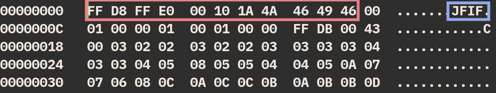

After saving the changes and opening the image again, I see that it's now available and it reveals the hidden directory

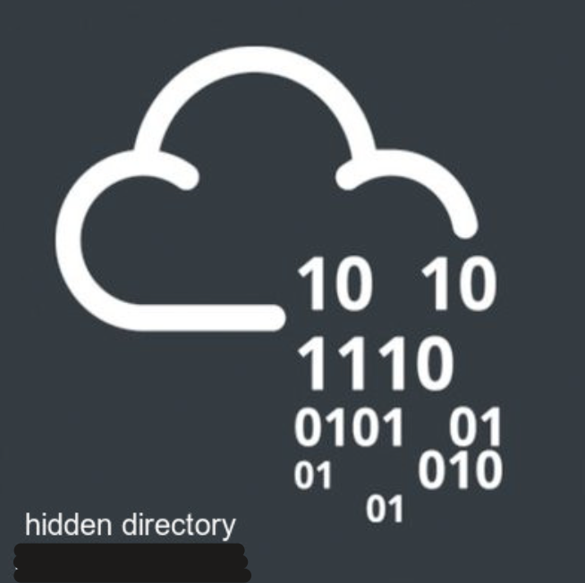

I enter the hidden directory in the browser and find a message:

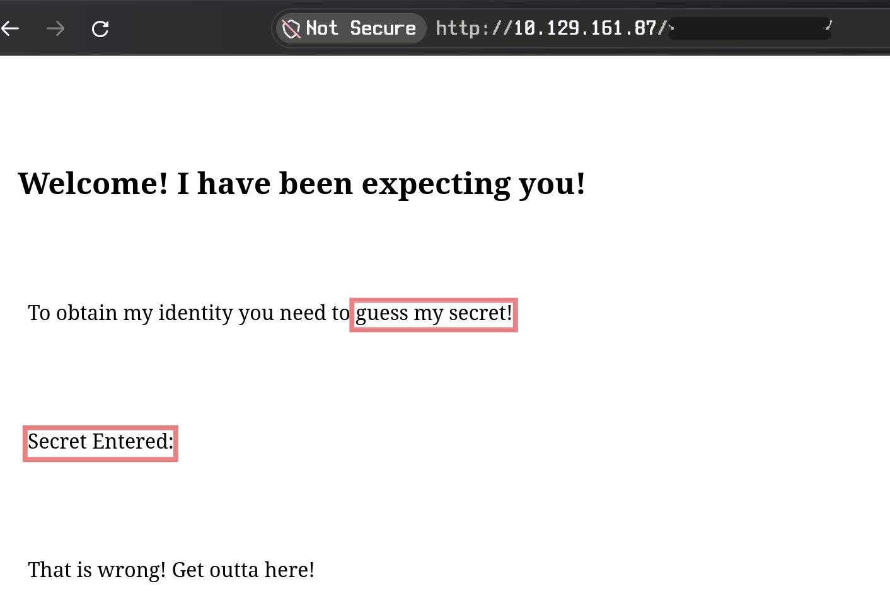

It asks me to enter the secret number, yet there's no input to type it in. I inspect the page's source code looking for clues...

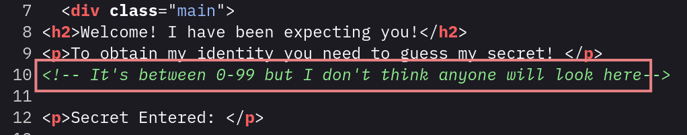

It says it's a number between 1 and 99, but before running a bruteforce, I need to understand how to make the page recognize a numeric input... After a while going in circles, trying parameters like `hiddenfoldername/?number=1`, I see that the site recognizes it if I use `?secret=1`

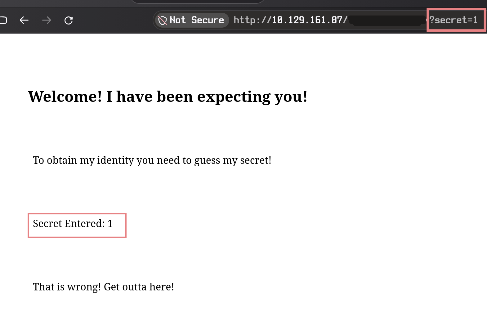

Having found the way to submit the number, I write a simple Python script using the `requests` library to try all 100 possibilities. Since the site uses the word `wrong`, its opposite is `right`, so I use this condition to find the correct value without too much verbosity from the program.

```py
import requests

for number in range(0,100):
    URL = f"http://<IP>/hiddendirectoryname/?secret={number}"
    response = requests.get(URL)
    if "right" in response.text:
        print(f"Correct number: {number}")
        print(response.text)
    else:
        pass

```

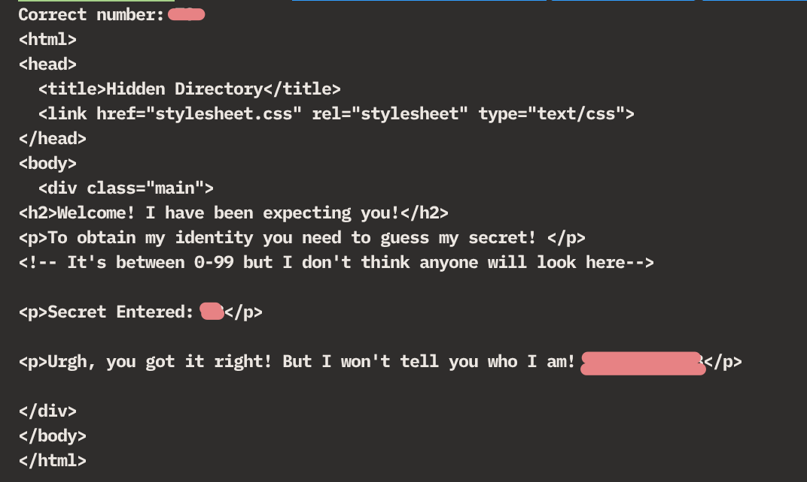

With the correct number, it returns a combination that looks like a password. I remember that binwalk showed the presence of embedded signatures in the corrupted image, so I try to extract the content with `steghide` and it asks me for a password. I enter the string found earlier when guessing the number on the site, and it extracts a text file.

* The provided password contains symbols; in order to extract it with `steghide` you must use the `-p` flag and the password inside '' so it doesn't cause conflicts.

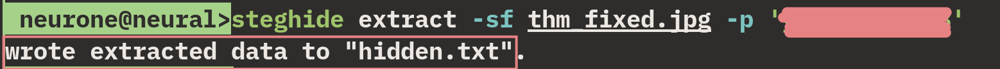

Reading the extracted file, it reveals a username made of an alphabetic combination of characters.

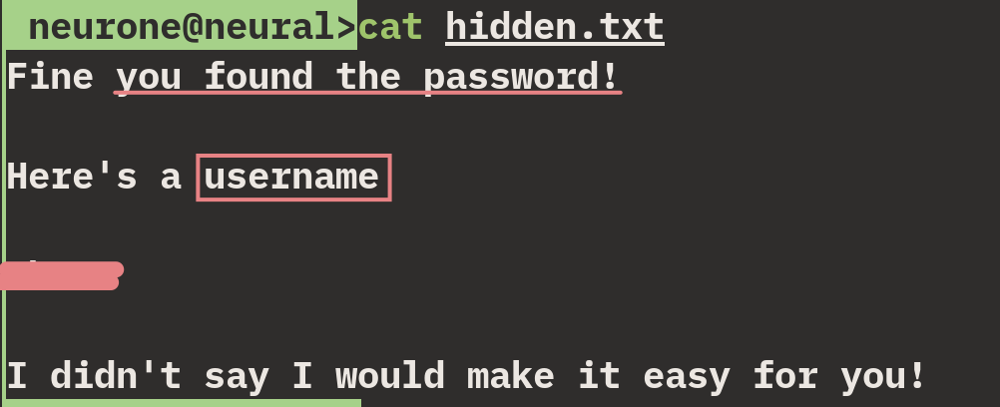

The first thing I try is to run the alphabetic string through `Cyberchef` to see if it's in `base64` format or some other... After many attempts, I tried rotating the characters because, since they were only letters, perhaps with a `Caesar` shift I could find a word that makes more sense as a username. Cyberchef provides `ROT13` as a base, which means a 13-character shift, though it lets you choose how many shifts you want to perform. Surprisingly, it wasn't necessary to rotate from the start (1 position, 2 positions, 3 p...) because a very meaningful word appeared with the default 13 shifts the filter provides.

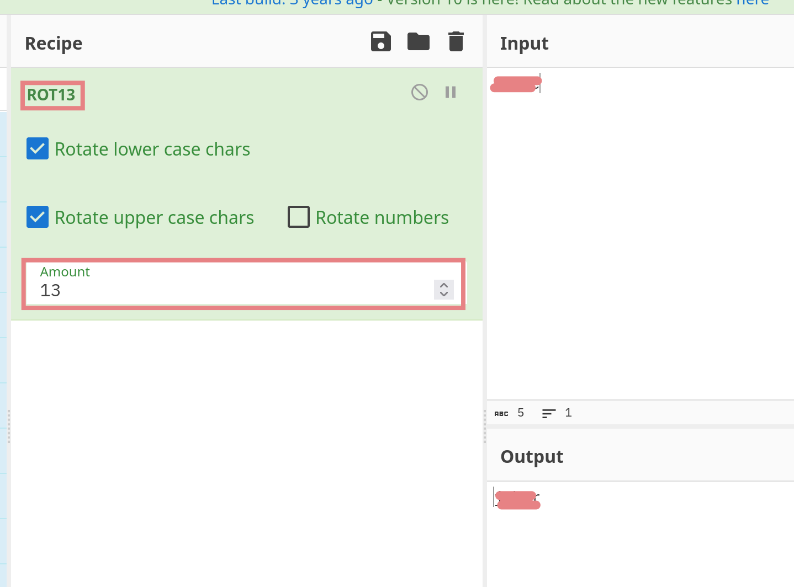

For now I have a username and a password (to extract the files). I get stuck for a good while until I 'think outside the box' and try investigating the TryHackMe room's image.

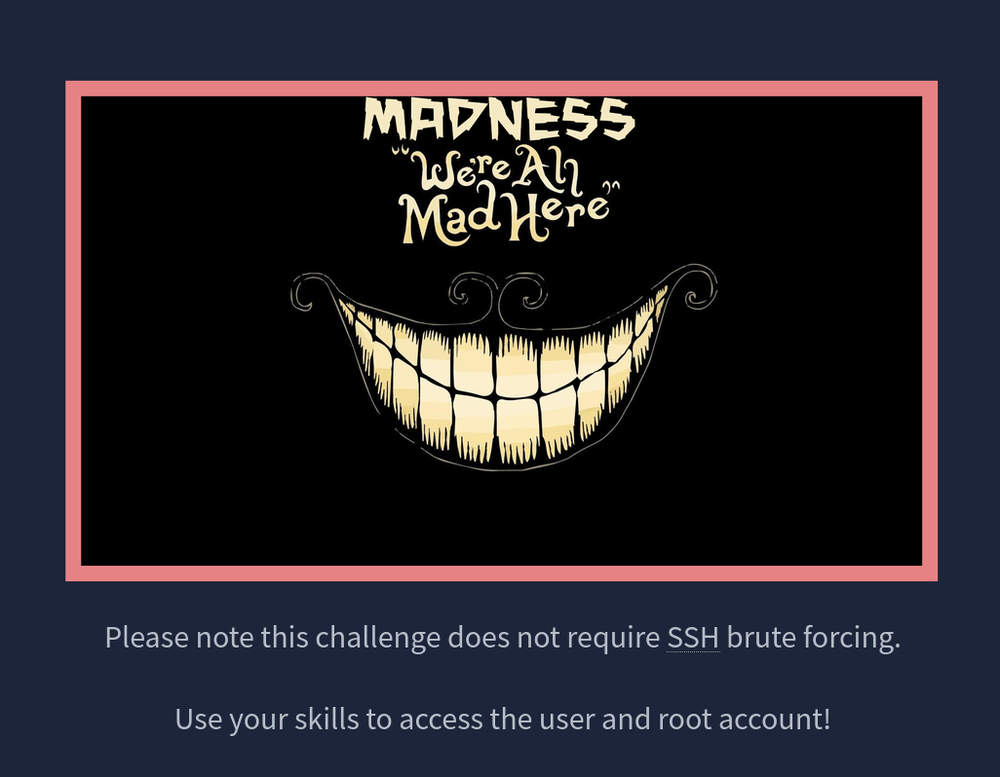

I download the image with `wget` and `binwalk` also shows me the presence of embedded files, so I directly try to extract with `steghide`. It asks for a password, I try the previous one and it doesn't work, I try without a password and it extracts successfully.

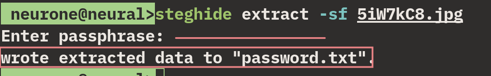

Reading the file, I see that it reveals a password...

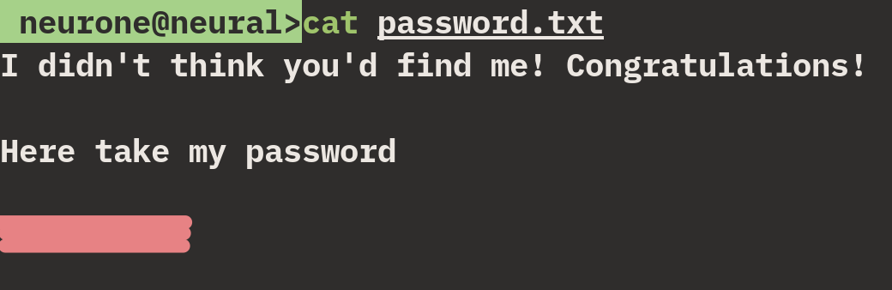

Since I have a username and a password, I think it's time to log in via `SSH`. (The username is hidden so as not to reveal earlier steps)

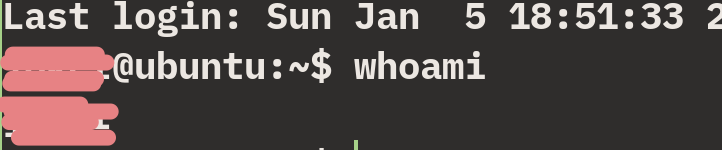

With `ls` I see a text file that turns out to be the first `FLAG`

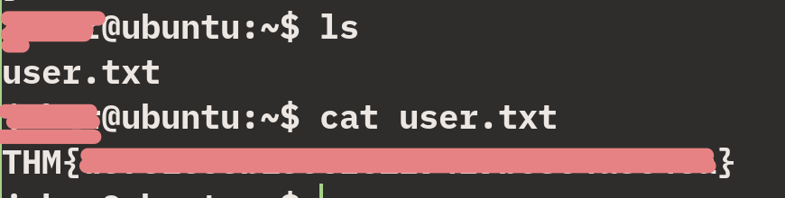

Now comes the long-awaited privilege escalation; for that I look for binaries that have the `SUID` bit (administrator 'root' executables that can be run by any user)

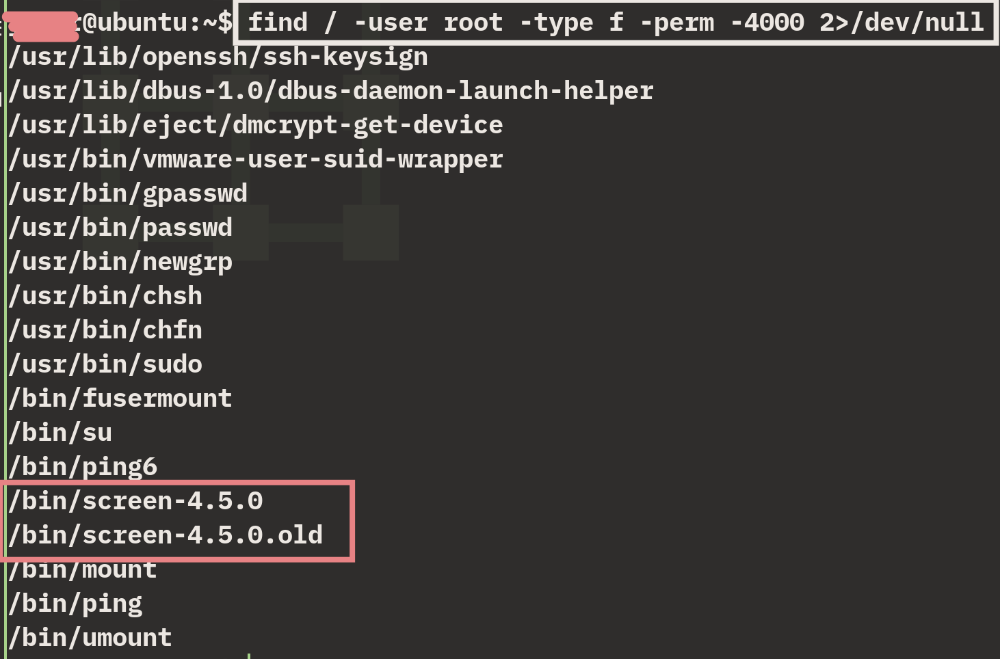

Of all the binaries present in my search, `screen-4.5.0` in particular catches my attention, especially because of the presence of `screen-4.5.0.old`, so I research more about this binary.
screen is a tool that lets you keep terminal sessions open in the background. Version 4.5.0 had a vulnerability that allowed running code with elevated privileges under certain conditions. If screen belongs to root and has SUID enabled, the exploit can end up running commands as root.

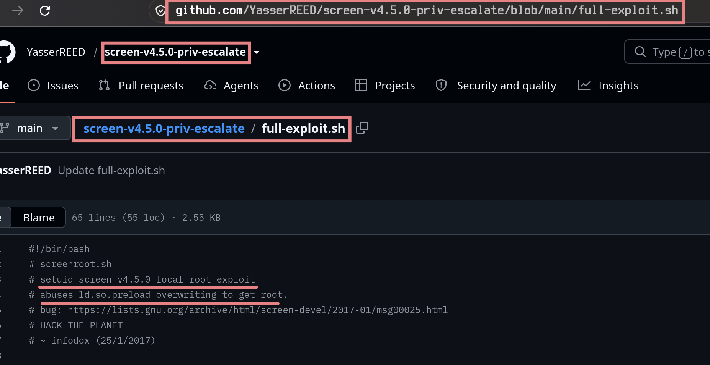

On the victim machine, I create a file `screen-4-5-0-exploit.sh` and, since it has `vim`, I rewrite the code, give it permissions, and run it.

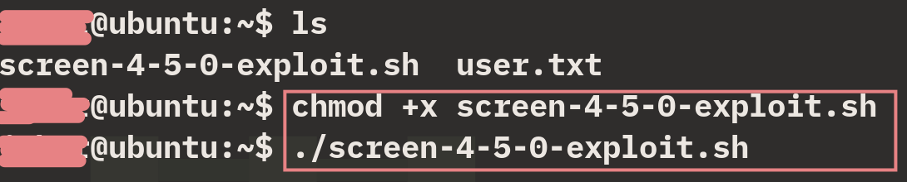

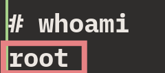

I navigate to the `/root` directory and with `ls` I see the `root` `FLAG` and read it.

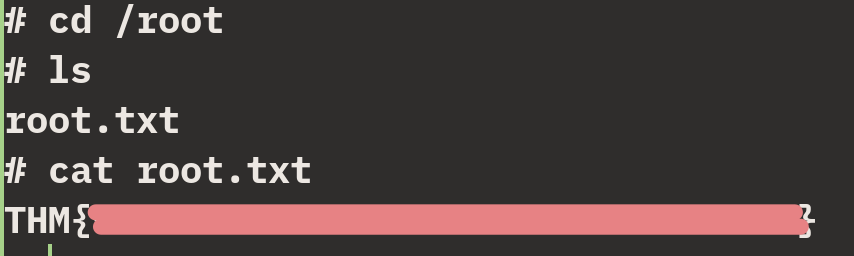

## THANK YOU - By tunlp

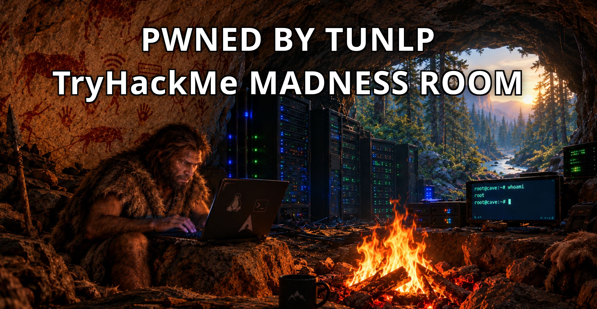
